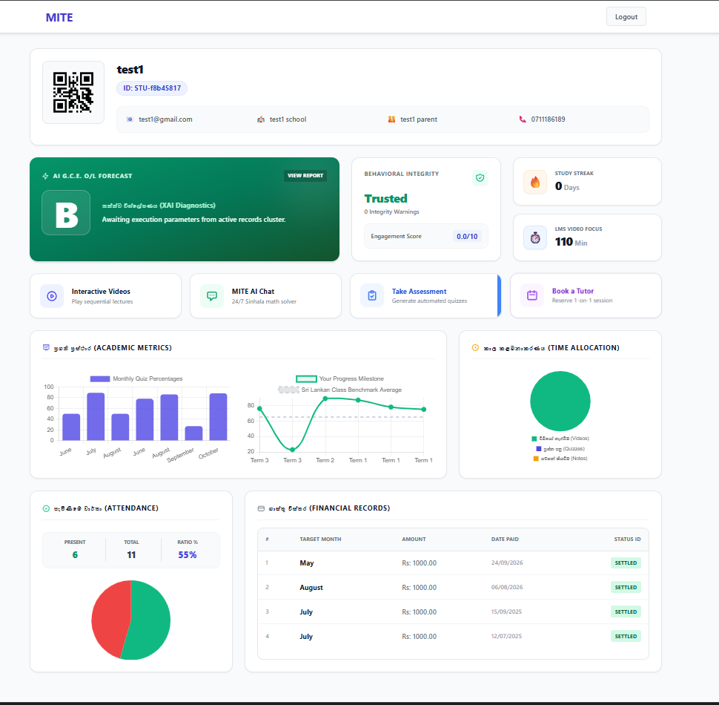
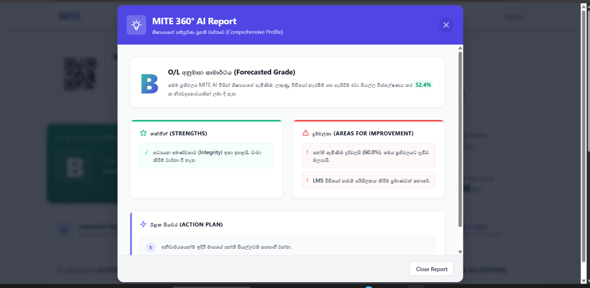
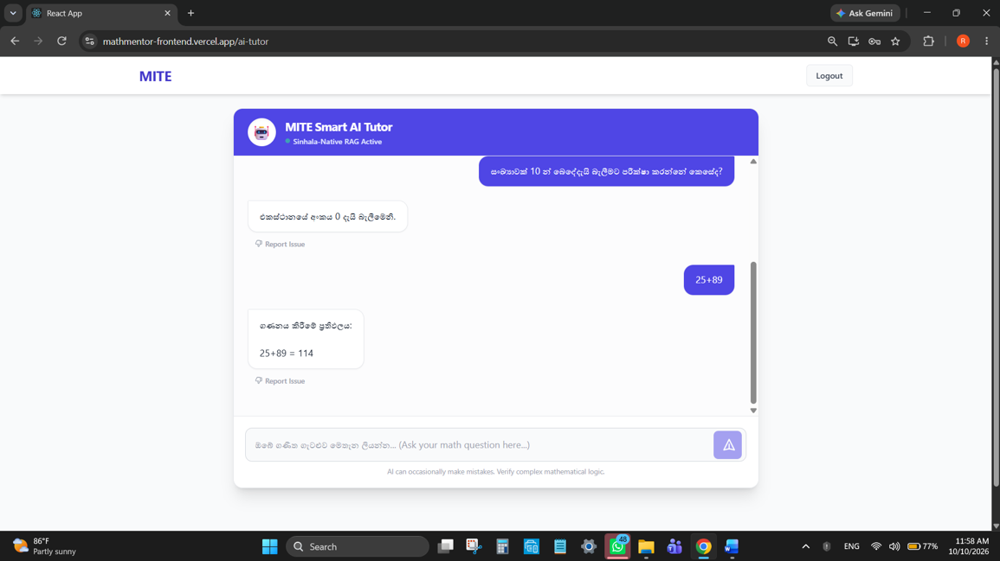
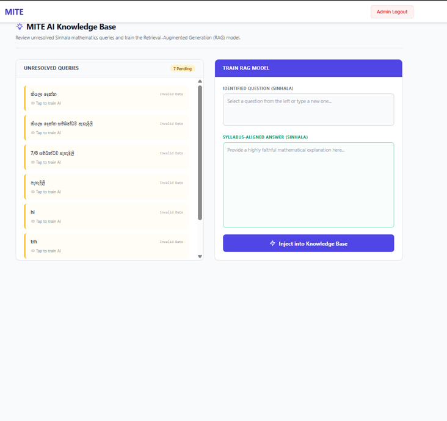
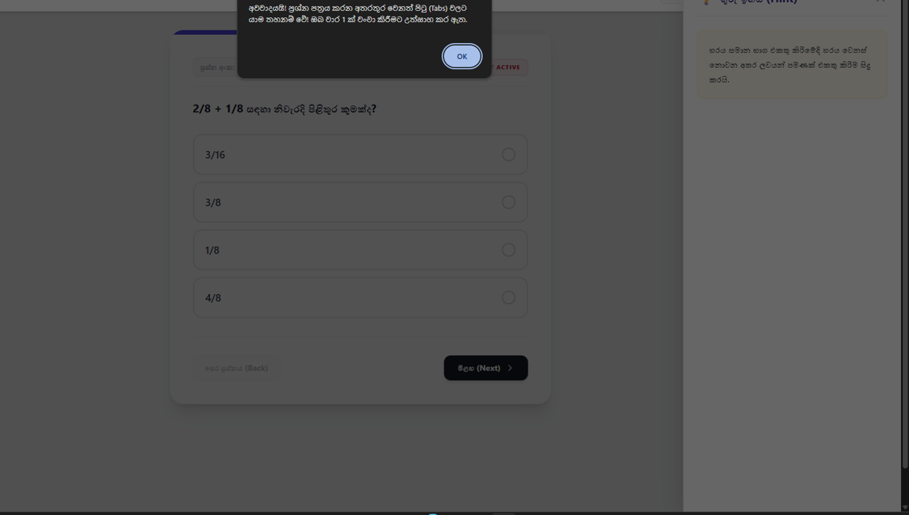
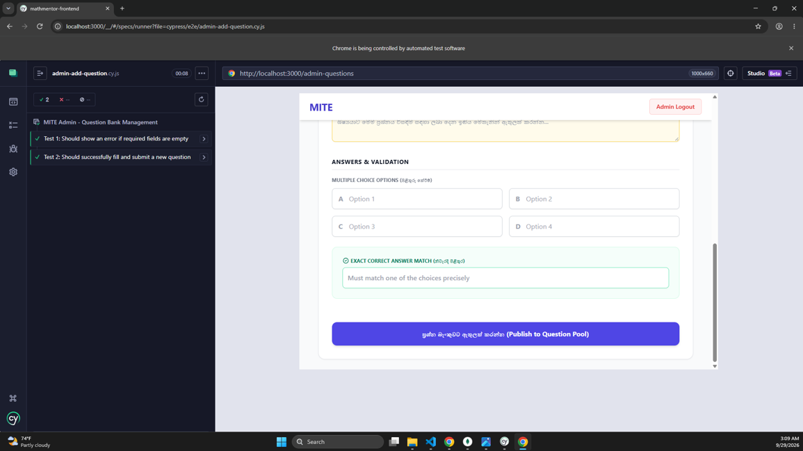

# MITE — Multi-Stakeholder Intelligent Tutoring Ecosystem


> **Live Platform:** [mathmentor-frontend.vercel.app](https://mathmentor-frontend.vercel.app/)  
> **Clean Architecture .NET 10 Rebuild (Public Code):** [MITE V2 Repository](https://github.com/Randilwelikala/MITE-V2)

---

## Overview

**MITE** (evolved from my production tuition LMS, *MathMentor*) is a full-stack, microservices-based intelligent tutoring platform engineered for **Sri Lankan G.C.E. O/L Mathematics (Grades 6–11)** as my BSc (Hons) Software Engineering final-year Design Science Research project.

Traditional private tuition systems operate as passive record buckets—leaving students without reliable Sinhala support during late-night self-study and leaving parents unaware of declining performance until term tests. MITE closes that gap through a **synchronized triadic ecosystem** (Student, Teacher/Admin, and Parent) powered by a **Sinhala-native RAG + SymPy AI tutor** and a **Random Forest predictive analytics engine with Explainable AI (XAI) diagnostics**.

---

## System Architecture

MITE decouples core application workflows from compute-heavy NLP and ML operations across three tiers:

```text
+-------------------------------------------------------------------+
|  Presentation Layer (React.js, Tailwind CSS, Chart.js, Vercel)    |
|  - Triadic Dashboards (Student / Parent / Admin)                  |
|  - Adaptive Quiz Engine + DOM visibilitychange Anti-Cheat         |
|  - Webcam QR Attendance Scanner (html5-qrcode + Web Audio API)    |
+---------------------------------+---------------------------------+
                                  | HTTPS / REST + JWT Auth
                                  v
+-------------------------------------------------------------------+
|  Application Gateway (Node.js, Express.js, Railway)               |
|  - Role-Based Access Control (JWT + bcryptjs + Firebase Reset)    |
|  - Concurrent Telemetry Aggregation (Promise.all)                 |
|  - Conflict-Safe 1-on-1 Scheduling & CRUD APIs                    |
+-----------------+-------------------------------+-----------------+
                  | Mongoose ORM                  | Internal HTTP Proxy
                  v                               v
+---------------------------------+   +-----------------------------+
|  MongoDB Atlas (NoSQL)          |   |  AI Microservice (Flask)    |
|  - Students, Attendance, Fees   |   |  1. SymPy Math Interceptor  |
|  - Marks, QuestionBank, Quizzes |   |  2. Sinhala-RoBERTa RAG     |
|  - VideoProgress, AIChatSession |   |     (0.72 Cosine Threshold) |
|  - Bookings & Activity Logs     |   |  3. Random Forest + XAI     |
+---------------------------------+   +-----------------------------+
```

---

## Key Engineering Highlights

### 1. Hybrid Sinhala-Native RAG & Symbolic Math Tutor
* **Deterministic Math Interception (`SymPy`):** Before invoking vector search, regex-sanitized arithmetic and algebraic equations are intercepted and solved locally via SymPy (<150 ms) to guarantee exact calculations with zero LLM math hallucinations.
* **Sinhala Semantic Retrieval:** Natural language queries in Sinhala/Singlish are encoded using `Ransaka/sinhala-roberta-sentence-transformer` (PyTorch) and matched via cosine similarity against a curated National Institute of Education (NIE) syllabus knowledge base.
* **Hallucination Guardrail & Human-in-the-Loop Training:** A strict **0.72 cosine similarity threshold** blocks low-confidence responses. Unresolved prompts are automatically routed to `unanswered.json`, where teachers inject verified syllabus explanations through the Admin Portal—hot-reloading tensor embeddings in memory without restarting the service.

### 2. Predictive Learning Analytics & Explainable AI (XAI)
* **G.C.E. O/L Grade Forecasting:** A Scikit-Learn `RandomForestClassifier` (`n_estimators=50`, `max_depth=4`, `class_weight='balanced'`) forecasts exam grades (`A, B, C, S, W`) from four continuous behavioral telemetry streams: `attendance_percent`, `avg_quiz_marks`, `video_minutes`, and `ai_chat_prompts`. Balanced class weights prevent overfitting toward majority grades and improve early detection of at-risk students.
* **MITE 360° XAI Diagnostics:** Translates raw predictions and behavioral flags (e.g., tab-switching integrity breaches or low video focus time) into human-readable **Strengths**, **Areas for Improvement**, and an **Action Plan** modal for students and parents.

### 3. Triadic LMS, Integrity & Automation Workflows
* **Webcam QR Attendance & Study Streaks:** Uses `html5-qrcode` with 60-second duplicate-scan debouncing, a synthesized **1000 Hz Web Audio API** confirmation beep, and real-time consecutive attendance streak calculation.
* **Adaptive Quizzes & Anti-Cheat Monitoring:** Dynamically escalates quiz difficulty (`Easy → Medium → Hard`) when batch accuracy reaches ≥ 50%, while a React `useEffect` listener on the DOM `visibilitychange` API detects tab-switching/window minimizing and records `cheatingFlags` in MongoDB.
* **Interactive Video Lessons & 1-on-1 Booking:** Supports YouTube/MP4 lessons with mandatory progress-gating checkpoint questions and conflict-checked tutor appointment scheduling (`409 Conflict` protection).
* **Financial & Academic Dashboards:** Real-time fee tracking with overdue row highlights, Chart.js performance trends, and PDF student ID card generation.

---

## Technology Stack

| Layer | Technologies |
| :--- | :--- |
| **Frontend** | React.js, Tailwind CSS, Chart.js, `html5-qrcode`, Web Audio API |
| **Backend Gateway** | Node.js, Express.js, Mongoose, JWT, `bcryptjs`, Firebase Auth |
| **AI / ML Microservice** | Python, Flask, PyTorch, `sentence-transformers` (Sinhala-RoBERTa), SymPy, Scikit-Learn, PyPDF2 |
| **Database** | MongoDB Atlas |
| **Testing & QA** | Cypress (E2E UI + Mochawesome Reports), Jest (API Integration Tests) |
| **Deployment** | Vercel (Frontend), Railway (Backend), Git & GitHub |

---

## Quality Assurance & Testing

* **Automated E2E & API Testing:** Verified critical student and admin flows (authentication, RBAC, question bank validation, adaptive quiz progression, and anti-cheat telemetry) using **Cypress** (with Mochawesome reporting) and **Jest**.
* **Real-World Usability Fix:** Live tuition deployment surfaced duplicate registration submissions caused by a 3–4 second server response gap; resolved by refactoring React form state for instant loading feedback and form reset on submit.

---

## Platform Screenshots

> *Upload exported images from your thesis into an `assets/` folder using the filenames below.*

| Student Dashboard & Analytics | MITE 360° AI Forecast & XAI Report |
| :---: | :---: |
|  |  |

| Sinhala-Native RAG & SymPy Tutor | Admin Portal & AI Knowledge Trainer |
| :---: | :---: |
|  |  |

| Adaptive Quiz & Anti-Cheat Alert | Automated Cypress E2E Test Report |
| :---: | :---: |
|  |  |

---

## Source Code Access & Evolution (MITE V2)

The V1 source repositories (`mathmentor-frontend`, `mathmentor-backend`, `MathMentor-AI`) remain **private** to protect active tuition student records, credentials, and academic submission integrity. Source access or a live walkthrough is available to recruiters and hiring managers upon request.

To inspect my public backend engineering work, explore **[MITE V2](https://github.com/Randilwelikala/MITE-V2)** — an ongoing from-scratch rebuild of the MITE backend in **C# / ASP.NET Core (.NET 10)** using **Clean Architecture**, **Entity Framework Core**, and **PostgreSQL**.

---

## Author

**Randil Gimantha Welikala** — BSc (Hons) Software Engineering Graduate (Second Class Upper Division)  
* **GitHub:** [github.com/Randilwelikala](https://github.com/Randilwelikala)
* **LinkedIn:** [linkedin.com/in/randil-welikala-03336b249](https://www.linkedin.com/in/randil-welikala-03336b249/)
* **Email:** [randilgimantha646@gmail.com](mailto:randilgimantha646@gmail.com)
